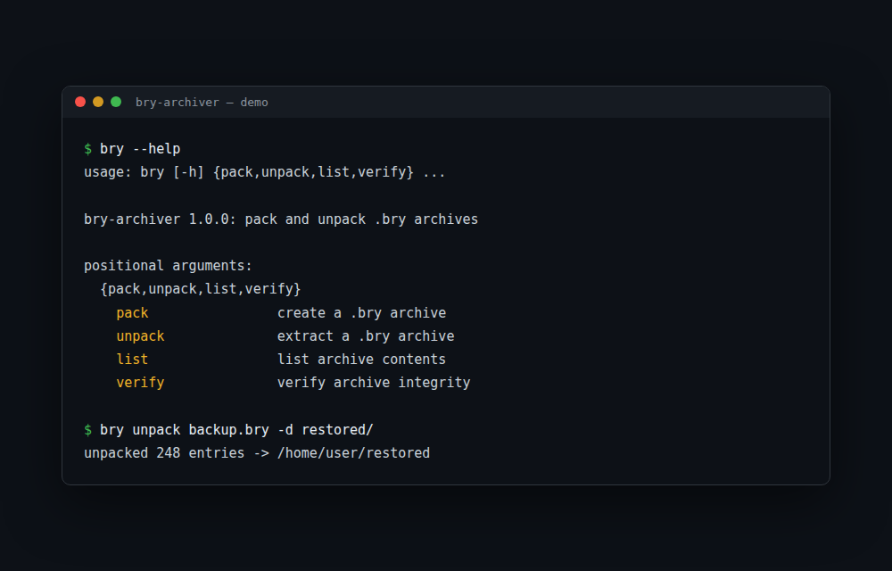

# bry-archiver


*Created by devuvo*

[](https://github.com/bryan-cantila/bry-archiver/actions)
[](LICENSE)
[](pyproject.toml)
[](pyproject.toml)

A cross-platform command-line compression tool that creates `.bry` archives.

```
$ bry pack photos/ documents/ -o backup.bry --level 9
packed 248 entries -> backup.bry (41.2 MB)

$ bry list backup.bry
    2.4 MB  photos/img_0042.jpg
  812.0 KB  documents/report.pdf
  ...
248 entries, 96.5 MB total

$ bry verify backup.bry
backup.bry: OK

$ bry unpack backup.bry -d restored/
unpacked 248 entries -> /home/user/restored
```

## Demo




## Features

- **`.bry` format** — an original archive format: magic-byte identification, per-file CRC32 integrity checks, zlib compression (levels 1–9)
- **Cross-platform** — pure Python standard library, runs on Windows, macOS, and Linux with Python 3.9+
- **Four commands** — `pack`, `unpack`, `list`, `verify`; nothing else to learn
- **Safe extraction** — entries that try to escape the destination directory are rejected
- **Unicode filenames** — entry names stored as UTF-8
- **Zero dependencies** — nothing to install beyond Python itself

## Install

```
pip install .
```

or, isolated from your system Python:

```
pipx install .
```

This provides the `bry` command. Requires Python 3.9 or newer.

## Usage

Create an archive from files and/or directories:

```
bry pack <paths...> -o archive.bry [--level 1-9]
```

Extract, list, or verify:

```
bry unpack archive.bry [-d destination/]
bry list archive.bry
bry verify archive.bry
```

`verify` decompresses every entry in memory and checks its CRC32 without writing anything to disk. Any mismatch reports the offending filename and exits non-zero.

## Format

`.bry` is a documented binary format — see [FORMAT.md](FORMAT.md) for the exact field layout. Readers reject files without the `BRY\x01` magic bytes, and any CRC or size mismatch names the corrupt file.

## Development notes

Original format and implementation, designed for this project. Built with an AI-assisted workflow: format spec and CLI behavior defined up front, implementation reviewed against the spec, full test suite green before release.

## License

**Free to use — just credit devuvo.** Personal, educational, and non-commercial use is free, provided you give visible credit (e.g. "Created by devuvo" with a link to https://www.devuvo.com). Using it for business or income-generating purposes? Notify devuvo first at admin@devuvo.com. See [LICENSE](LICENSE) for the full terms.
